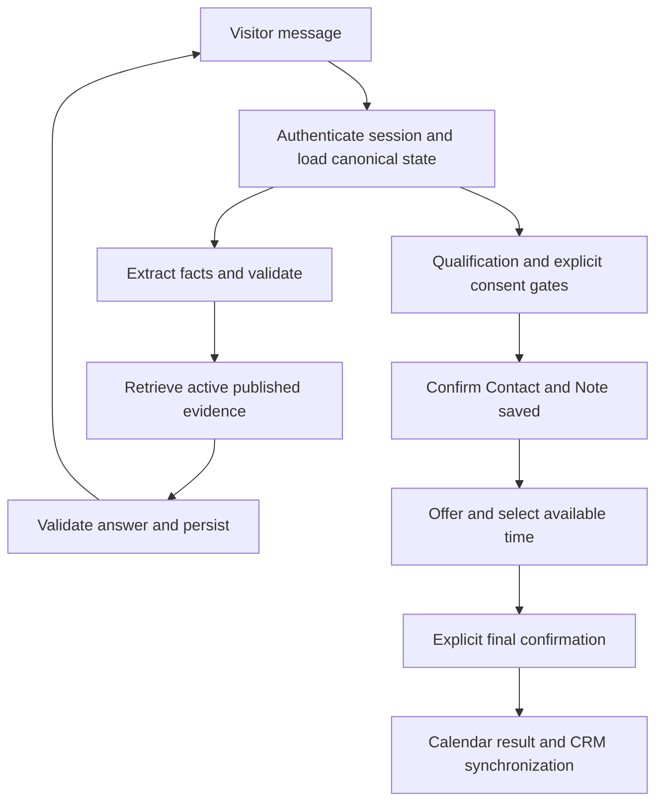

# LeadDesk

A local-first AI consultation reference application for a fictional marketing agency. It answers from published documents, qualifies a prospect, obtains consent, saves a CRM contact and note, and offers a consultation only after the required state is confirmed.

The initial clean snapshot was verified with **259 automated tests across 31 files**, strict TypeScript checking, lint and a production build. These checks use isolated test services; they are not a production security certification, live-account setup guarantee or load benchmark.

**Open-source code, not a hosted service.** No app deployment, production accounts, model credentials, customer records, or model weights are included. This is a clean source snapshot rather than a publication of the original development history.

## What it does

- Full-page consultation UI, responsive summary and explicit next steps.
- Replies in the visitor's language; interface and published sample corpus are English.
- Document-grounded answers with internal evidence validation. Source/model diagnostics are not shown to visitors.
- Meta Ads, Google Ads, or both; explicit budget-basis, website and start-date assessment.
- Separate consent for CRM storage and human-review requests.
- HubSpot Contact + Note confirmation before calendar availability is offered.
- Select a time, review it, then explicitly confirm a 30-minute Google Calendar booking.
- Durable conversation state, version fences, operation journals and read-first recovery for uncertain outcomes.
- Allowlisted Supabase-admin authentication, knowledge publication, human-review inbox and integration status/reconciliation.

The agency, prices and policies in `data/agency` are synthetic examples, not an offer of actual marketing services or performance guarantees.

## Stack and boundaries

| Component | Role |
|---|---|
| Next.js / React / TypeScript | Visitor/admin UI and server-side HTTP endpoints |
| LangChain Core | Prompt preparation and model-call composition |
| LangGraph + PostgreSQL checkpoints | Stateful workflow routing; not autonomous authorization |
| PostgreSQL + pgvector | Conversations, facts, consents, journals and document retrieval |
| Supabase | Managed PostgreSQL and administrator authentication; the app uses direct `pg` database access |
| Local multilingual E5 | Pinned 384-dimensional embeddings; explicit preparation, no runtime download/fake vectors |
| OMP stdio bridge | Locally authenticated model calls, without giving the product AI coding tools |
| HubSpot / Google Calendar | Separately configured test integrations |



### AI access is operator-supplied

This snapshot uses the existing **OMP `auth-gateway stdio`** integration. It does not contain a direct paid Gemini/OpenAI API adapter or any shared subscription credentials. An OMP CLI exposing that command was verified during development; install/authenticate it independently using [upstream instructions](https://github.com/can1357/oh-my-pi).

The configured selectors are `google-antigravity/gemini-3.8-flash` with `openai-codex/gpt-5.6-luna` as a bounded fallback. Availability and entitlement depend on the operator's upstream account. A selector string is not a guarantee of access. Do not share credentials or assume an individual subscription permits public hosting. No inference credits are provided and upstream services may incur charges.

Moving to official provider API keys, deploying to Cloudflare or another host, and choosing a cloud embeddings strategy are **not implemented deployment features of this snapshot**.

## Quick start

Prerequisites: **Node.js 24+**, npm, and Docker when running the isolated PostgreSQL regression suite.

```sh
git clone https://github.com/Chudien-2923/leaddesk.git
cd leaddesk
npm ci
sh scripts/check.sh
npm run dev
```

The page opens at `http://127.0.0.1:3000`. The checks do not require real integration credentials. Without configured services, the UI can load but consultation/integration requests fail safely; there is no fake-success or mock-chat runtime fallback.

For working consultation, follow [local setup](docs/SETUP.md): configure your own PostgreSQL/Supabase project, apply the migrations to a new authorized database, prepare the local E5 cache, publish the sample knowledge, and configure OMP authentication. HubSpot and Calendar are separate optional capabilities with their own credentials and permissions.

Copy `.env.example` to `.env.local` only for your own environment. Never commit populated values, OAuth token files, visitor cookies or customer data.

## Checks and development

```sh
sh scripts/check.sh      # route type generation, strict typecheck, lint, tests, production build
npm test                 # unit tests plus disposable PostgreSQL/pgvector tests
npm run dev              # local development server
```

The DB tests require a working Docker daemon and use a disposable `pgvector/pgvector:pg16` container, never your `DATABASE_URL`. Model/network boundaries are controlled in automated tests. `smoke:models`, knowledge seeding, OAuth authorization and integration smoke commands are explicit operator actions, not part of the default automated test gate.

The small declaration-only patch in `patches/` keeps the pinned Transformers.js dependency compatible with strict TypeScript without `skipLibCheck`; `npm ci` applies it with `patch-package`. See [third-party notices](THIRD_PARTY_NOTICES.md).

Stop any development server before production checks. If switching between dev and production leaves stale generated `.next` declarations, remove only that generated build directory and rerun the gate; do not loosen TypeScript or test assertions.

## Safety and limitations

- Conversation authorization is per browser session/capability, not a visitor account. There is no cross-browser identity synchronization or guaranteed two-day session persistence.
- Database history is not identical to model context. Recent history and structured facts are bounded; the app does not automatically summarize the entire transcript.
- Input/context budgets are heuristic estimates, not provider-tokenizer measurements. Prompt caching/TTL, load capacity and an SLA have not been established.
- The local installation limits new conversations to five per hour across the installation, and visitor messages to twenty per conversation per hour. These are safeguards, not measured user capacity or a public-IP abuse-control system.
- The E5 threshold was calibrated on only eight English sample queries with a narrow margin. Neither retrieval scores nor valid source IDs guarantee every answer is semantically correct.
- Explicit consent, successful CRM persistence and booking confirmation are backend conditions. AI text alone cannot authorize a write or prove success.
- Unknown external outcomes remain unknown until verified. Do not rotate request keys, create replacement sessions, or blindly retry to escape uncertainty.
- PostgreSQL reservations protect this application's bookings, not all possible races with external writers on Google Calendar.
- No emails, attendees, invitations or meeting links are added by the booking flow. Changing/canceling an appointment is not a self-service feature here.
- No production hardening, native Safari certification, public load test or guarantee for 100,000 concurrent users is claimed.

## Repository layout

```text
src/                    UI, domain policies, HTTP and integration services
supabase/migrations/    Ordered PostgreSQL schema and security migrations
data/agency/            Synthetic English knowledge/policy examples
tests/                  Domain, protocol, safety and isolated PostgreSQL regressions
scripts/                Checks, explicit model/cache/seed/OAuth/smoke commands
public/brand/           Runtime SVG branding
patches/                Pinned dependency declaration patch
docs/SETUP.md           Local environment and integration instructions
licenses/               Applicable third-party license texts
```

Internal work logs, original account identifiers, operator receipts, private configs, legacy prototypes and the original Git history are intentionally not part of this repository.

## Contributing and security

Use synthetic data in issues and tests. Before proposing a change, run `sh scripts/check.sh` and preserve the authorization, consent, version and unknown-outcome invariants. Do not attach credentials, cookies, raw provider responses or real customer records to an issue. See [SECURITY.md](SECURITY.md) for disclosure guidance. Maintenance and support are provided on a best-effort basis.

## License

Original project code, documentation and original LeadDesk SVG brand artwork are licensed under **[MIT](LICENSE)**. Dependencies and third-party-derived portions retain their own licenses; see [THIRD_PARTY_NOTICES.md](THIRD_PARTY_NOTICES.md). No trademark registration, exclusivity or third-party endorsement is claimed.
